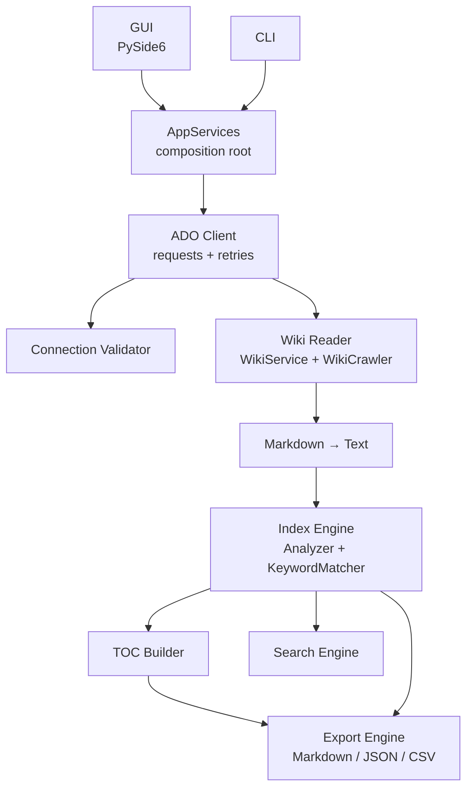
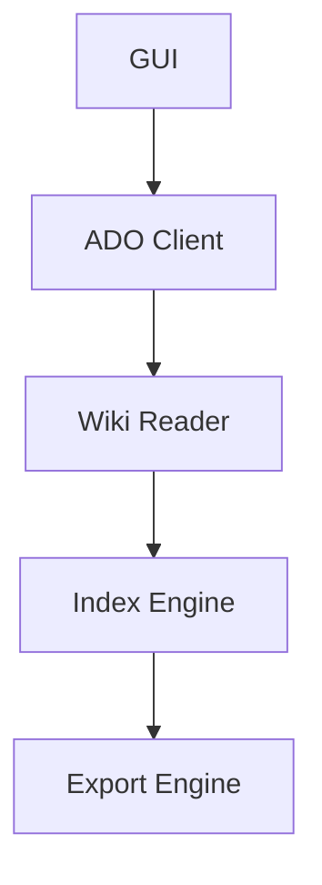

# Azure DevOps Wiki Indexer

A Windows desktop application that connects to an Azure DevOps project and reads every page of every wiki in it. It then builds a hierarchical table of contents and a searchable term index, and exports the results to Markdown, JSON and CSV.

It is designed for large wiki estates (10,000+ pages): pages are downloaded in parallel with bounded concurrency, retries and back-off. Progress is reported throughout, and a run can be cancelled at any point.

- **Connection validation** checks the PAT, the organisation, the project and wiki permissions, and reports any failure precisely.
- **Wiki discovery** finds project wikis and code (published) wikis, with their name, type, repository, root path and published branches.
- **Recursive crawling** reads the full page hierarchy, including content and last author/date.
- **Content processing** turns Markdown into clean text. It handles headings, tables, code, links, images, embedded HTML and Azure DevOps extensions such as `[[_TOC_]]`, `::: mermaid` and `@mentions`.
- **Indexing** extracts standard terms with stemming (NLTK) or lemmatisation (spaCy), filters stop words, and counts every occurrence of your custom keywords and phrases.
- **Search** offers exact phrase, keyword (stemmed, TF-IDF ranked), regex and fuzzy (typo-tolerant) modes.
- **Exports** produce Markdown (page tree, `toc.md`, `index.md`, `summary.md`), JSON and CSV.
- **Security**: the PAT is stored only in Windows Credential Manager, masked in the UI, and never written to config or logs.
- **Packaging**: a standalone `.exe` (PyInstaller) and a Windows installer (Inno Setup).
- **Command line** (`AzureDevOpsWikiIndexerCli.exe`) for scheduled or automated runs.

---

## Contents

- [Installation](#installation)
- [Azure DevOps permissions](#azure-devops-permissions-required)
- [Usage](#usage)
- [Configuration](#configuration)
- [Output](#output)
- [Architecture](#architecture)
- [Security](#security)
- [Building from source](#building-from-source)
- [Testing](#testing)
- [Troubleshooting](#troubleshooting)

---

## Installation

### Option 1: Installer (recommended)

1. Run `AzureDevOpsWikiIndexerSetup.exe`.
2. Choose a per-machine install (requires admin) or a per-user install, and optionally create a desktop shortcut.
3. Launch **Azure DevOps Wiki Indexer** from the Start menu.

No Python installation is required. To uninstall, use **Settings → Apps** or the Start-menu uninstall shortcut. Your settings, logs, exports and stored PAT are kept.

### Option 2: Run from source

Requires **Python 3.12+** on Windows.

```powershell
git clone https://github.com/ivesma/AzDoProjectWikiAnalysis.git
cd AzDoProjectWikiAnalysis
py -3.12 -m venv .venv
.venv\Scripts\Activate.ps1
pip install -r requirements.txt
$env:PYTHONPATH = "src"
python -m wiki_indexer            # GUI
python -m wiki_indexer.cli --help # CLI
```

Alternatively, `pip install -e .` installs the `wiki-indexer` (GUI) and `wiki-indexer-cli` commands.

#### Optional: spaCy lemmatisation

By default the indexer uses NLTK's Snowball stemmer, which needs no data download. For dictionary-based lemmatisation, install spaCy and its English model:

```powershell
pip install spacy
python -m spacy download en_core_web_sm
```

With `"analyzer": "auto"` (the default), spaCy is used automatically when available. The installer build does not bundle spaCy, to keep its size down.

---

## Azure DevOps permissions required

Create a **Personal Access Token** at `https://dev.azure.com/{org}/_usersSettings/tokens` with these scopes:

| Scope | Why |
|---|---|
| **Wiki – Read** | Enumerate wikis and read pages (required) |
| **Project and Team – Read** | Verify that the project exists (required for *Test Connection*) |
| **Code – Read** | Resolve repository names and the last author/date of each page (optional; without it these fields are left blank) |

The account also needs *Read* permission on the wiki itself (**Project settings → Wiki → Security**). For code wikis, it needs *Read* on the backing repository.

Authentication uses HTTP Basic with an empty user name and the PAT as the password, as Azure DevOps expects.

---

## Usage

### Desktop application

1. **Organisation URL**: for example `https://dev.azure.com/myorg`. `https://myorg.visualstudio.com` and Azure DevOps Server collection URLs also work.
2. **Project**: for example `MyProject`.
3. **Personal Access Token**: masked by default; use *Show* to reveal it.
4. Click **Test Connection**:

   ```text
   ✓ Connected
   Organisation: myorg
   Project: MyProject
   Wiki Count: 3
   ```

   If the connection fails, the status names the cause, for example `✗ Invalid PAT`, `✗ Organisation not found`, `✗ Project not found` or `✗ Access denied to Wiki`.

   If **Remember PAT** is ticked, a successful test saves the PAT to Windows Credential Manager and clears the field. Later runs use the stored PAT unless you type a new one.

5. Click **Index Wikis**. The progress bar shows each stage: reading page trees, reading pages, processing content, indexing and exporting. Click **Cancel** to stop at any time.
6. Explore the results in these tabs:
   - **Wikis**: name, type, repository, root path, published branches and page count.
   - **Table of Contents**: the page hierarchy, with a rendered preview and the last author.
   - **Index**: every custom keyword and term, with page and occurrence counts. Filter it, then double-click a page to open it.
   - **Search**: choose *Keyword*, *Exact phrase*, *Regex* or *Fuzzy*. Double-click a result to open the page.
   - **Settings**: edit `appsettings.json` and the custom keyword list.
   - **Log**: live application log.
7. Click **Open Output Folder** to browse the exported files.

#### Search modes

| Mode | Example | Matches |
|---|---|---|
| Keyword | `deploy cluster` | Pages containing all terms after stemming (`deployments`, `clusters` …), ranked by TF-IDF. Custom keywords such as `Azure DevOps` are answered from the keyword index. |
| Exact phrase | `terraform plan` | Case-insensitive literal phrase |
| Regex | `terraform\s+(plan\|apply)` | Python regular expression (case-insensitive, multiline) |
| Fuzzy | `Databriks` | Terms, keywords and page titles within a similarity threshold (typo-tolerant) |

### Command line

```powershell
$env:AZDO_PAT = "<your PAT>"   # or omit to use the PAT stored by the GUI

# Test the connection only
AzureDevOpsWikiIndexerCli.exe --org https://dev.azure.com/myorg --project MyProject --test

# Index, export to a folder and search
AzureDevOpsWikiIndexerCli.exe --org https://dev.azure.com/myorg --project MyProject `
    --output D:\WikiExports\MyProject --threads 16 --search Terraform

# Fuzzy search
AzureDevOpsWikiIndexerCli.exe --org https://dev.azure.com/myorg --project MyProject --search "Databriks" --mode fuzzy
```

```text
Search Term: Terraform

Found in:

Architecture/IaC
Runbooks/BuildPipeline
```

The CLI exits with `0` on success, `1` on failure, `2` for missing arguments and `130` when cancelled with Ctrl+C.

---

## Configuration

### `appsettings.json`

| Setting | Default | Description |
|---|---|---|
| `exportMarkdown` | `true` | Write `wiki/`, `toc.md`, `index.md` and `summary.md` |
| `exportJson` | `true` | Write `wiki.json`, `toc.json`, `index.json` and `wikis.json` |
| `exportCsv` | `true` | Write `page_inventory.csv` and `keyword_index.csv` |
| `outputDirectory` | `""` | Export folder; empty uses the default location (see below) |
| `threadCount` | `10` | Parallel page downloads (1–64) |
| `requestTimeoutSeconds` | `30` | Per-request timeout |
| `maxRetries` | `5` | Retries for HTTP 429/5xx, with exponential back-off that honours `Retry-After` |
| `fetchLastModified` | `true` | Look up the last author and date per page (one extra API call per page) |
| `indexCustomKeywords` | `true` | Index the keywords from `keywords.json` |
| `indexStandardTerms` | `true` | Extract significant terms with the language analyser |
| `analyzer` | `"auto"` | `auto`, `spacy`, `nltk` or `basic` |
| `includeCodeBlocks` | `true` | Index the text inside fenced and indented code blocks |
| `minTermLength` | `3` | Ignore shorter words |
| `minTermDocumentFrequency` | `1` | Only list terms that appear on at least this many pages |
| `organizationUrl`, `project` | `""` | Last connection used (saved automatically; never the PAT) |
| `rememberPat` | `true` | Store the PAT in Windows Credential Manager after a successful test |

### `keywords.json`

```json
{
  "keywords": ["Terraform", "AKS", "Azure DevOps", "PowerShell", "Databricks"]
}
```

Keywords are matched case-insensitively and as whole words, so `AKS` does not match `tasks`. Multi-word phrases match across any whitespace, and keywords that contain symbols, such as `C#` or `.NET`, also work. Every occurrence is counted.

### File locations

| | Installed | From source |
|---|---|---|
| Settings and keywords | `%APPDATA%\AzureDevOpsWikiIndexer\` | `config\` |
| Logs | `%LOCALAPPDATA%\AzureDevOpsWikiIndexer\logs\application.log` | `logs\application.log` |
| Default output | `Documents\AzureDevOpsWikiIndexer\output\` | `output\` |

Set the environment variable `WIKI_INDEXER_HOME` to keep everything under one folder, which is useful for portable or CI use.

---

## Output

```text
output/
├── wiki/                     # every page as its original Markdown, hierarchy preserved
│   ├── Architecture.md
│   ├── Architecture/
│   │   ├── Components.md
│   │   └── Security.md
│   └── Runbooks.md
├── toc.md                    # nested list with links into wiki/
├── index.md                  # ## Term → pages
├── summary.md                # counts, wikis, top terms, failed pages, structure tree
├── wiki.json                 # full page tree with content and metadata
├── toc.json
├── index.json                # { "Terraform": ["/Architecture/IaC", ...] }
├── wikis.json                # wiki metadata
├── page_inventory.csv        # one row per page
└── keyword_index.csv         # term, type, location, occurrences
```

- When a project has **several wikis**, each wiki gets its own sub-folder under `wiki/`, and index locations take the form `WikiName:/path`.
- Page file names are made Windows-safe: invalid characters and reserved names are replaced, and case-insensitive collisions get a `~2` suffix.
- The `wiki/` folder is regenerated on every export, so deleted pages disappear. This only happens in folders the tool created itself; it never deletes a `wiki/` folder it did not create.

Example `index.md`:

```markdown
# Index

## Databricks
- [DataPlatform](wiki/DataPlatform.md)

## Terraform
- [Architecture/IaC](wiki/Architecture/IaC.md)
- [Runbooks/BuildPipeline](wiki/Runbooks/BuildPipeline.md)
```

---

## Architecture



The minimal flow from the specification:



### Project structure

```text
├── src/wiki_indexer/
│   ├── gui/           # MainWindow, settings panel, Qt workers, log handler, index table model
│   ├── ado/           # AdoClient, ConnectionValidator, WikiService, WikiCrawler, models, errors
│   ├── indexing/      # markdown_text, analyzers, keyword_matcher, index_builder, toc, search
│   ├── exporters/     # Markdown / JSON / CSV exporters behind an Exporter protocol
│   ├── config/        # AppSettings, KeywordStore, AppPaths
│   ├── utils/         # logging, SecretString, credentials, cancellation, progress, file names
│   ├── pipeline.py    # discover → crawl → extract → index → TOC → export
│   ├── services.py    # facade used by GUI and CLI (dependency injection root)
│   ├── app.py         # GUI entry point
│   └── cli.py         # command line entry point
├── config/            # default appsettings.json and keywords.json
├── assets/            # application icon
├── installer/         # PyInstaller spec, Inno Setup script, icon generator
├── tests/             # pytest suite
├── output/            # default export folder when running from source
├── build.ps1          # one-command build
├── requirements.txt
└── README.md
```

Python packages live under `src/wiki_indexer/` rather than directly under `src/`. Generic top-level names such as `config` or `utils` could otherwise clash with other installed packages.

### Design notes

- **SOLID and dependency injection**: each concern sits behind a small interface (`TextAnalyzer`, `Exporter`, `CredentialStore`, `ProgressCallback`). The `AppServices` composition root wires them together, and the GUI receives `AppServices` through its constructor, so every layer can be tested in isolation.
- **Concurrency**: the `WikiCrawler` uses `concurrent.futures.ThreadPoolExecutor` with a bounded submission window (4 × threads), so memory stays flat for very large wikis. A shared `requests` connection pool is sized to the thread count. The GUI runs jobs on a `QThreadPool` and receives progress through queued Qt signals.
- **Resilience**: HTTP 429 and 5xx responses are retried with back-off and honour `Retry-After`. A page that fails to load is recorded and reported in `summary.md` without stopping the crawl. An expired PAT does stop the run immediately.
- **Logging**: `logs/application.log` holds JSON lines (one object per line) with structured fields such as `url`, `status`, `elapsedMs`, `wiki` and `path`. It rotates at 5 MB and keeps 5 backups. Connection events, every API call, errors and export operations are logged.

---

## Security

- **The PAT is never written to disk in plain text.** It is stored only through `keyring` in Windows Credential Manager (DPAPI-protected, per user), under the target name `AzureDevOpsWikiIndexer` and keyed by organisation URL. Click **Settings → Forget Stored PAT** to remove it.
- **The PAT field is masked**, and it is cleared once the PAT has been stored or when the window closes. A stored PAT is never loaded back into the text field.
- **In-memory handling**: the PAT is held in a `SecretString` (a mutable `bytearray`) that is zeroed after each operation and is masked in `repr()`, so it cannot leak into logs. The HTTP session's `Authorization` header is dropped when the client closes.
  > Python cannot guarantee that every transient copy of a string is erased (for example, the encoded header that `requests` builds). The design keeps the number and lifetime of such copies to a minimum.
- **Logs** contain URLs, status codes and timings, but never request headers or the PAT.
- Use a **read-only, short-lived PAT** with only the scopes listed above.

---

## Building from source

Prerequisites: Python 3.12 (`py -3.12`) and, for the installer, [Inno Setup 6](https://jrsoftware.org/isinfo.php) (`winget install JRSoftware.InnoSetup`).

```powershell
.\build.ps1                  # venv + deps → tests → PyInstaller → Inno Setup
.\build.ps1 -SkipTests       # faster iteration
.\build.ps1 -SkipInstaller   # executable only
```

Artifacts:

| File | Description |
|---|---|
| `dist\AzureDevOpsWikiIndexer\AzureDevOpsWikiIndexer.exe` | Standalone GUI (with its runtime folder) |
| `dist\AzureDevOpsWikiIndexer\AzureDevOpsWikiIndexerCli.exe` | Standalone CLI |
| `dist\installer\AzureDevOpsWikiIndexerSetup.exe` | Installer with Start-menu and desktop shortcuts, uninstaller, version info and icon |

To run the steps by hand:

```powershell
pyinstaller installer\AzureDevOpsWikiIndexer.spec --noconfirm --clean
& "${env:ProgramFiles(x86)}\Inno Setup 6\ISCC.exe" /DMyAppVersion=0.1.0 installer\AzureDevOpsWikiIndexer.iss
```

The version number comes from `src/wiki_indexer/__init__.py` and is stamped into both executables and the installer. To regenerate the icon, run `python installer\make_icon.py`.

PyInstaller uses a one-folder build, because it starts much faster than `--onefile` and is what the installer packages.

---

## Testing

```powershell
pip install -r requirements-dev.txt
$env:QT_QPA_PLATFORM = "offscreen"     # run GUI tests headless
pytest --cov                           # fails if coverage drops below 80 %
```

The suite mocks the Azure DevOps REST API with `responses`, so it needs no network access or real organisation. It covers connection validation, error mapping, crawling (including cancellation, page failures and large estates), Markdown processing, analysers, index building, search modes, all exporters, the CLI, and the GUI (via `pytest-qt`).

---

## Troubleshooting

| Symptom | Cause / fix |
|---|---|
| `✗ Invalid PAT` | The PAT is wrong, expired or revoked, or was created for a different organisation. Create a new one. Azure DevOps sometimes answers a bad PAT with a sign-in page (HTTP 203); this is detected and reported the same way. |
| `✗ Organisation not found` | Check the URL: `https://dev.azure.com/{org}` with no project or path after it. |
| `✗ Cannot reach Azure DevOps` | Network, proxy or TLS problem. Set the `HTTPS_PROXY` environment variable if you are behind a proxy. |
| `✗ Project not found` | Check the spelling; names with spaces are fine. The PAT also needs *Project and Team (Read)*. |
| `✗ Access denied to project` / `✗ Access denied to Wiki` | Add the *Wiki (Read)* scope to the PAT, and check the wiki security settings. |
| Wiki Count is 0 | The project has no wiki yet, or only a code wiki you can't read. |
| *Last modified* columns are empty | The PAT lacks *Code (Read)*, or `fetchLastModified` is off. |
| Indexing is slow or HTTP 429 appears in the log | Azure DevOps is rate-limiting you. Retries are automatic; lower `threadCount` (for example to 4–6) for very large estates, or turn off `fetchLastModified` to halve the number of API calls. |
| Some pages show an error in `summary.md` | Those pages returned an error after all retries, for example because they were deleted mid-crawl. Re-run the job. |
| *Remember PAT* does nothing | No Credential Manager backend is available, for example in some locked-down sessions. Check the log; the PAT is then used for the current session only. |
| Analyzer shows `nltk` although spaCy is installed | The `en_core_web_sm` model is missing: `python -m spacy download en_core_web_sm`. |
| Where are the logs? | `%LOCALAPPDATA%\AzureDevOpsWikiIndexer\logs\application.log` (installed) or `logs\` (from source). The path is shown in the status bar. |
| Windows SmartScreen warns about the installer | The binaries are unsigned. Sign them with `signtool` (set `SignTool=` in the `.iss` file) for distribution. |

---

## License

MIT. See [LICENSE](LICENSE).
